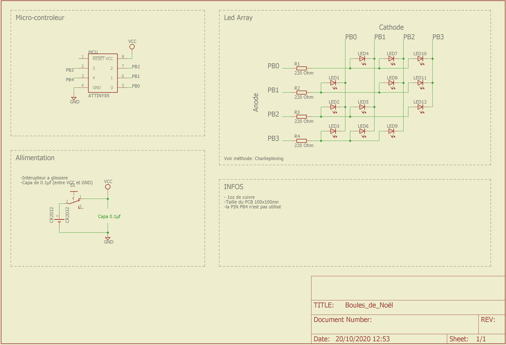
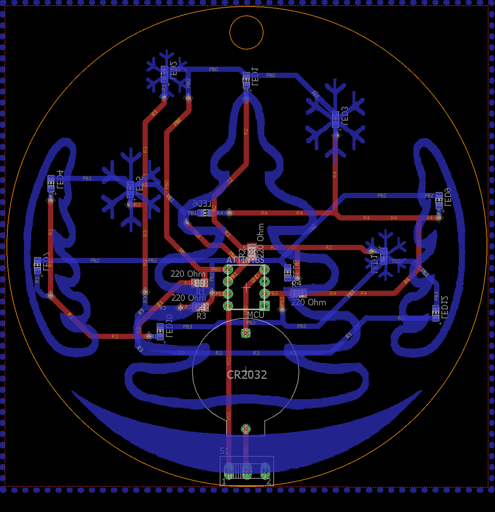

# Christmas Balls

Realization of Christmas ball in PCB, for the pleasure of young and old.
The principle is to build a colored printed circuit.
Programmable colored LEDs will be implemented in a design directly referring to the Christmas spirit.

## General idea

The Christmas balls will have to be autonomous to last the time of the end of year celebrations.
It must be on battery or on pilsner with a small, energy-efficient microcontroller.

A Christmas design should be simple and easily recognizable. It will integrate LEDs cost effectively.

## Shematic

## Board

